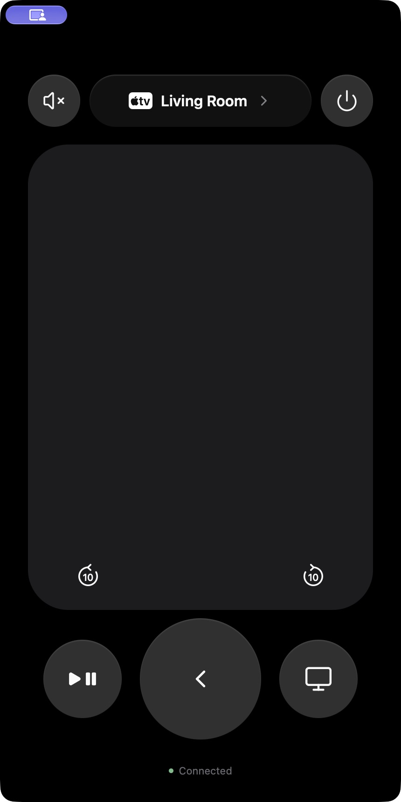

# ATV Remote Desktop

A desktop Apple TV remote for macOS, Windows and Linux, built with Tauri 2, Rust and React/TypeScript. Discovery, PIN pairing, encrypted connections, playback, text input and device state run directly in Rust through [ratv](https://github.com/henrikwidlund/ratv). There is no Python runtime or helper process.

<p align="center">
  
</p>

## Development

Install Node.js, Rust stable (1.100 or newer) and the [Tauri platform prerequisites](https://v2.tauri.app/start/prerequisites/).

```sh
npm ci
npm run tauri dev
```

On macOS, use the rustup Cargo/Rust binaries ahead of an older Homebrew installation in PATH. The Rust dependency is pinned to a reviewed ratv revision; Cargo.lock and package-lock.json record all resolved dependencies.

## Usage

Your Mac or PC and Apple TV must be on the same local network. Select the Apple TV and enter the PIN displayed on the television once. The app remembers the last paired device and first tries its saved endpoints on startup. If a port or address changed, it rediscovers the device without discarding the pairing keys. Existing credentials from earlier pyatv-based app versions are imported when the device is rediscovered.

Arrow keys navigate, Enter selects, Escape/Backspace go back, and Space plays or pauses. Swipe the touch surface to navigate or click it to select. Drag the empty top bar to move the window.

Skip controls appear only when active media supports seeking. They send an explicit ten-second interval. Text input appears when a text field on Apple TV is focused. The information button opens actual playback metadata. Unavailable controls stay hidden. State comes from protocol updates; status reads do not perform network queries or block remote commands.

Pairing keys are stored in the user application data folder, with owner-only file permissions on Unix. Never publish files from that folder.

## Build and validation

```sh
cargo test --manifest-path src-tauri/Cargo.toml --locked
cargo clippy --manifest-path src-tauri/Cargo.toml --locked -- -D warnings
npm run package
```

Build outputs are in `src-tauri/target/release/bundle`. The application executable supports `--health` for an offline packaged-runtime smoke test.

GitHub Actions builds macOS Apple Silicon/Intel (DMG), Windows x64 (NSIS/MSI) and Linux x64 (DEB/AppImage). Each platform runs native Rust tests, lint checks and a packaged-executable smoke test. Linux packages target systems compatible with Ubuntu 24.04's glibc and WebKitGTK 4.1.

## macOS signing

Local signing uses an installed Apple-issued certificate:

```sh
APPLE_SIGNING_IDENTITY='Your signing identity' npm run package
```

For CI signing configure these repository secrets:

- `APPLE_CERTIFICATE_BASE64`: exported code-signing identity as a base64-encoded PKCS#12 file, including its private key.
- `APPLE_CERTIFICATE_PASSWORD`: the PKCS#12 export password.
- `APPLE_SIGNING_IDENTITY`: the exact certificate identity.

Tagged macOS builds fail when signing secrets are missing, instead of silently producing an unsigned release. Branch/PR builds can compile unsigned. Public distribution should use a Developer ID Application certificate and notarization; notarization credentials are not configured yet. macOS Local Network permission is still required even for signed apps.

## References

- [ratv: Rust Apple TV protocol implementation](https://github.com/henrikwidlund/ratv)
- [Original interface inspiration](https://github.com/bsharper/atv-desktop-remote)
- [CI structure reference](https://github.com/ismkdc/openwrt-manager)
